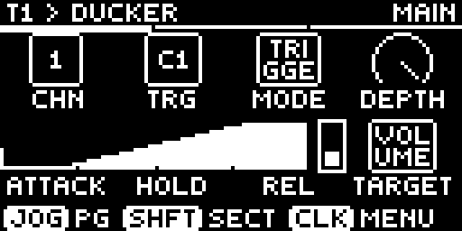
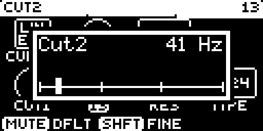
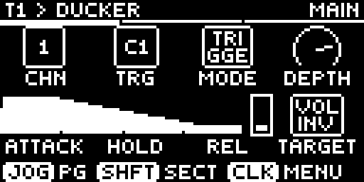

# Ducker

MIDI-triggered sidechain ducker for [Schwung](https://github.com/charlesvestal/schwung) on Ableton Move. A MIDI note, usually the kick, triggers an envelope that ducks the volume, opens an inverted volume, or sweeps a filter. No audio sidechain needed.



*Main page, default settings at 120 BPM, mid-duck. Rendered at 4x from Schwung's page preview.*

## Setup

Load as an audio FX on the slot to duck. Set **Channel** and **Trigger** to the kick's MIDI channel and note (set the drum track's MIDI Out with Shift + Track). Only that note on that channel triggers.

## Main page

| Knob | Control | Range | Default | Notes |
|---|---|---|---|---|
| 1 | Channel | Omni, 1-16 | 1 | |
| 2 | Trigger | C-2 to G8 | C1 (36) | |
| 3 | Mode | Trigger, Gate | Trigger | Gate: the duck stays down while the note is held and releases on note-off. The envelope's Hold time (knob 6) is not used |
| 4 | Depth | 0-100% | 100% | |
| 5 | Attack | 0-50 ms | 5 ms | |
| 6 | Hold | 0-500 ms | 100 ms | |
| 7 | Release | 0-1000 ms | 300 ms | |
| 8 | Target | Volume, Volume Inv, Filter | Volume | Picks what the envelope moves, and which second page appears |

## Targets

- **Volume**: ducks the gain by Depth.
- **Volume Inv**: rests at 1 - Depth and opens to full on each trigger. Rests only while the transport runs; stopped, the signal passes at full level.
- **Filter**: sweeps the cutoff from Cut1 towards Cut2 by Depth, in octaves. For high-pass, set Cut1 low and Cut2 high.

## Second page: Volume and Volume Inv

| Knob | Control | Range | Default | Notes |
|---|---|---|---|---|
| 1 | Curve | Linear, Expo, S-Curve, Pump | Linear | Shapes attack and release. Pump: linear attack, ease-out release |
| 2 | Vel Sens | 0-100% | 0% | See below |
| 3 | Retrig | Hard, Soft | Soft | See below |

## Second page: Filter

| Knob | Control | Range | Default | Notes |
|---|---|---|---|---|
| 1 | Curve | Linear, Expo, S-Curve, Pump | Linear | As on the Volume page |
| 2 | Vel Sens | 0-100% | 0% | As on the Volume page |
| 3 | Retrig | Hard, Soft | Soft | As on the Volume page |
| 5 | Cut1 | 20 Hz-20 kHz | 9.9 kHz | Cutoff at rest |
| 6 | Cut2 | 20 Hz-20 kHz | 41 Hz | Cutoff at full Depth |
| 7 | Res | 0-90% | 20% | |
| 8 | Type | LP12, LP24, HP12, HP24 | LP24 | |

Cutoffs have 128 log steps; hold a cutoff knob to see Hz.



## Vel Sens

How much the trigger's velocity scales Depth:

- **0%**: every hit ducks by the full Depth.
- **50%**: velocity 127 gets the full Depth, velocity 0 half of it.
- **100%**: depth follows velocity: 127 gets the full Depth, 64 about half, 0 none.

## Retrig

- **Hard**: a new hit restarts the duck from fully open.
- **Soft**: a new hit continues from the current level along the attack curve, so full duck still lands one attack time after the hit. A hit asking for less depth keeps the deeper level.

In Gate mode a note shorter than the attack still completes the attack.

## Display

The envelope spans one beat at the current tempo; notches mark 16ths. The meter shows the current gain (Volume Inv: low at rest, full on trigger).



## Build and install

```bash
./scripts/build.sh     # Docker build, writes dist/ducker-module.tar.gz
./scripts/install.sh   # copies dist/ducker to move.local over ssh
```

Also available in the Schwung Module Store.

## AI Assistance Disclaimer

This module is part of Move Everything and was developed with AI assistance, including Claude, Codex, and other AI assistants.

All architecture, implementation, and release decisions are reviewed by human maintainers.  
AI-assisted content may still contain errors, so please validate functionality, security, and license compatibility before production use.
